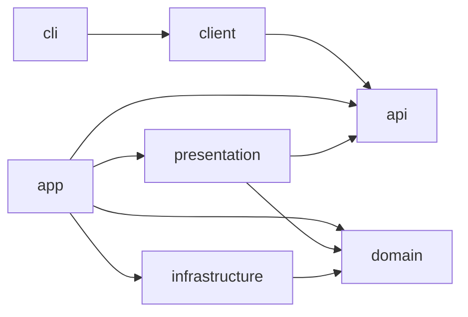

# Architecture

TeamCode is an independent, self-hosted team gateway. Root package and Gradle group: `me.nathanfallet.teamcode`. All project content is English. The module layout follows Asonar's public contract/client and inward-facing server layers. TeamCode does not depend on ControlResell code, credentials, CI, infrastructure, registries or databases.

## Module graph

| Module | Responsibility | Runtime |
| --- | --- | --- |
| api | Serializable DTOs, typed Ktor resources, public error and event contracts | KMP, JVM and desktop Native |
| client | Typed TeamCode HTTP client, credential supplier and bounded streaming transport; caller supplies the engine | KMP, JVM and desktop Native |
| cli | Native commands, local proxy, browser login, OS credentials, agent integration and service registration | Kotlin/Native; JVM for fast tests |
| domain | Models, use cases, repository/service ports, admission, fairness, capacity forecasts and model selection | Server JVM; no HTTP or database dependency |
| infrastructure | Provider adapters, OAuth, database, encryption, HTTP transports and telemetry | Server JVM |
| presentation | Typed management API, incoming inference protocols, dashboard and agent-facing MCP | Server JVM |
| app | Server composition root, Koin, configuration, lifecycle and OCI image | JVM 21, Ktor Netty |

Infrastructure does not import public DTOs. Presentation maps domain objects to contracts and invokes use cases. CLI never imports server domain or repositories. Native platform code belongs behind `expect/actual` boundaries. The HTTP client accepts a caller-selected engine and credential supplier; the SDK never owns an operating system keychain.

## Deployment

One server process and an independent MySQL database for the first team deployment. Use Exposed, Hikari and reviewed Flyway migrations; schema tests replay migrations against MySQL. No RabbitMQ or Redis requirement initially. Durable directives and quota reservations live in the database. No database lock spans an inference stream.

The local CLI embeds an HTTP loopback-only Ktor CIO server. Outbound HTTPS uses Darwin on macOS, Curl on Linux, and WinHttp on Windows. Server CIO and client CIO are different concerns: never assume Native client TLS works merely because the local HTTP server works. The central server uses Netty on JVM.

Native targets: macosArm64, macosX64, linuxX64, linuxArm64, mingwX64. Publish target binaries and checksums; document dynamic library requirements. Compile and test on appropriate hosts, not only JVM. Do not promise static binaries or supported targets before their release artifacts pass verification.

## Request lifecycle

1. Authenticate the TeamCode member; derive identity from the credential, never caller-controlled identity headers.
2. Validate endpoint, model capabilities, project policy, output bound and request size.
3. Atomically reserve the member/group/run allowance including other in-flight reservations.
4. Admit through bounded per-member queues and fair scheduling. Recheck policy at dispatch.
5. Select an authorized provider account with conversation affinity, respecting every relevant quota window and protected sub-pool.
6. Stream with backpressure. Record every provider attempt and its usage; stop upstream work on disconnect.
7. Settle the reservation exactly once. Missing final usage retains a conservative provision for reconciliation.

Do not replay after committed output. Keep provider exhaustion, transient throttling, transport failures and member budget denials separate. Credential refresh is serialized per account. Secrets use versioned atomic updates, so a late refresh cannot overwrite newer credentials.

## Public management contracts

The API owns resources, DTOs and serialization. The client exposes resource subclients and accepts an HTTP engine factory. Version management API under `/api/v1`; inference surfaces retain the upstream-compatible `/v1/messages` and `/v1/responses` paths. Publish capabilities so CLI and server can negotiate compatibility rather than guess feature availability. A planned command must not be advertised as implemented.

## Models and protocols

Separate the caller's requested name, team routing profile, actual provider model and selected account. An alias such as `opus -> astra` is a policy, not a statement that the models share capabilities or protocol. Native passthrough preserves opaque provider fields. Translation is an explicit, tested capability subset: text, tool calls/results, fragmented streaming arguments, stop reasons and errors first. Images and advanced features require their own evidence.

Do not silently discard signed/encrypted reasoning, tool state or unknown required fields. Refuse unsupported capability combinations. Keep routes sticky across tool loops; changing provider requires a compatible session boundary. A paid API fallback or a different data destination requires explicit policy. ChatGPT/Codex subscriptions and OpenAI API credentials are distinct adapters; their tokens are not interchangeable.

## Data and security

Conceptual tables: teams, members, memberships, devices, sessions, service keys, provider accounts, pools, policies, quota observations, reservations, requests, upstream attempts, usage events, route versions, directives, receipts and audit events. Identity and events are team-scoped. IDs, tokens and session names are not metric labels. Telemetry is optional and content-free by default.

Provider credentials are encrypted at rest with the encryption key outside the database. Member/device credentials are revocable and scope-limited. Web sessions use Secure/HttpOnly/SameSite cookies and CSRF protection. Bootstrap is closed by default. No public GitHub login automatically grants membership.

Metrics describe bounded operational outcomes; individual usage is protected management data. Do not log prompts, responses, credentials or raw provider error bodies. Store only metadata unless an operator explicitly opts into a documented, short-lived diagnostic mode.
